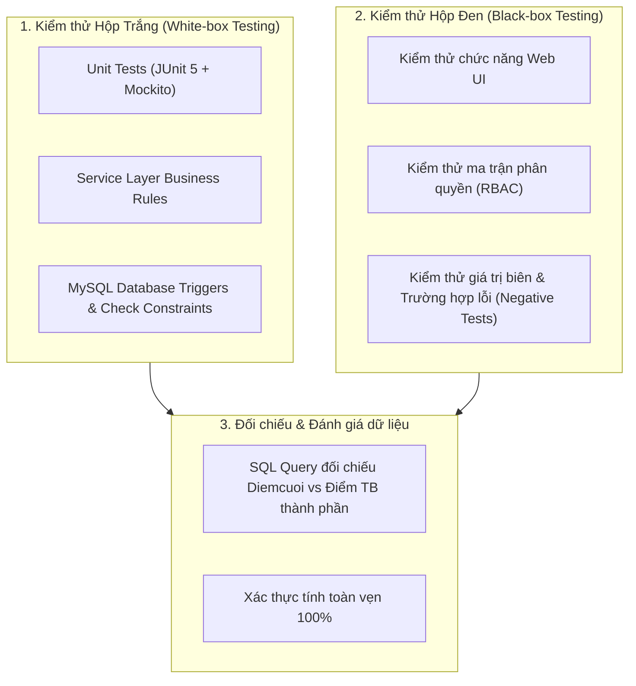

# BÁO CÁO ĐỒ ÁN MÔN HỌC: LẬP TRÌNH WEB
**ĐỀ TÀI: XÂY DỰNG HỆ THỐNG QUẢN LÝ ĐỀ TÀI SINH VIÊN (HCMUTE)**

---

# CHƯƠNG 7: KIỂM THỬ VÀ ĐÁNH GIÁ HỆ THỐNG

- **Sinh viên thực hiện:** Trần Hữu Lộc
- **Nhiệm vụ phân công:** Mục 8 – Chương 7: Kiểm thử & Đánh giá (Môi trường test; test case; login/role; CRUD; ràng buộc nghiệp vụ; expected/actual; kết quả)
- **Người đánh giá / Reviewer:** Thu Thảo

---

## 7.1. MỤC TIÊU VÀ PHẠM VI KIỂM THỬ

### 7.1.1. Mục tiêu kiểm thử
Kiểm thử phần mềm là giai đoạn then chốt nhằm phát hiện sớm các khiếm khuyết, bảo đảm hệ thống vận hành đúng đặc tả kỹ thuật và đáp ứng đầy đủ các quy tắc nghiệp vụ của trường ĐH Sư phạm Kỹ thuật TP.HCM (HCMUTE). Cụ thể:
1. **Xác thực tính năng đăng nhập và ma trận phân quyền (RBAC):** Đảm bảo mỗi vai trò (Trưởng khoa, Trưởng bộ môn, Giảng viên, Sinh viên) chỉ được thao tác đúng phạm vi quyền hạn được cấp; ngăn chặn triệt để hành vi truy cập trái phép URL (HTTP 403 Forbidden).
2. **Kiểm tra tính toàn vẹn dữ liệu (CRUD & Database Constraints):** Đảm bảo các bảng danh mục hoạt động ổn định, không vi phạm khóa chính, khóa ngoại (FK) và các ràng buộc toàn vẹn dữ liệu.
3. **Thẩm định chặt chẽ các ràng buộc nghiệp vụ đặc thù:**
   - **Giảng viên phản biện (GVPB):** Giảng viên không được làm phản biện hoặc tự chấm điểm cho đề tài do chính mình hướng dẫn; ngăn chặn phân công trùng lặp.
   - **Hội đồng đánh giá:** Mỗi hội đồng bắt buộc có đúng từ 3 đến 5 giảng viên; đúng 1 Chủ tịch; đúng 1 Thư ký; các thành viên còn lại là Ủy viên; không trùng giảng viên.
   - **Chấm điểm & Kết quả trung gian:** Điểm thành phần bắt buộc nằm trong thang điểm $[0.00, 10.00]$; điểm cuối cùng được tính chính xác bằng trung bình cộng các điểm thành phần (làm tròn 2 chữ số thập phân theo quy tắc `HALF_UP`) và khớp 100% với dữ liệu lưu trữ.

### 7.1.2. Phạm vi kiểm thử
- **Kiểm thử tầng nghiệp vụ (Service Layer):** Kiểm thử đơn vị (Unit Test) sử dụng JUnit 5 và Mockito.
- **Kiểm thử tầng cơ sở dữ liệu (Database Layer):** Kiểm thử ràng buộc bảng (Check Constraints), Unique Keys và Trigger MySQL.
- **Kiểm thử giao diện người dùng (Web UI Layer):** Kiểm thử trải nghiệm thực tế trên trình duyệt web, kiểm tra thông báo lỗi (Error Alert) và thông báo thành công (Flash Message).

---

## 7.2. MÔI TRƯỜNG VÀ CÔNG CỤ KIỂM THỬ (TEST ENVIRONMENT)

Hệ thống được kiểm thử toàn diện trên môi trường máy tính cục bộ với các thông số cấu hình chuẩn sau:

| Thành phần | Thông số / Công nghệ sử dụng | Ghi chú |
| :--- | :--- | :--- |
| **Hệ điều hành (OS)** | Microsoft Windows 11 64-bit | Môi trường máy trạm nhà phát triển |
| **Java Development Kit** | Oracle OpenJDK 26 (LTS compatible) | Biên dịch và chạy ứng dụng |
| **Framework Backend** | Spring Boot 3.x (Spring Data JPA, Spring Security, Spring MVC) | Nền tảng chính |
| **Template Engine** | Thymeleaf 3.x | Kết xuất giao diện Web UI |
| **Hệ quản trị CSDL (DBMS)**| MySQL Server 8.0.x (Community Edition) | Lưu trữ CSDL `Quanlydetaisinhvien` |
| **JDBC Driver** | `mysql-connector-j` | Kết nối Spring Data JPA với MySQL |
| **Framework kiểm thử** | JUnit 5 (Jupiter), Mockito Core | Kiểm thử tự động (Automated Testing) |
| **Công cụ đóng gói** | Apache Maven 3.9.x | Quản lý build và chạy `mvn test` |
| **Trình duyệt web** | Google Chrome 120+, Microsoft Edge | Kiểm thử giao diện Web UI |
| **Địa chỉ truy cập cục bộ** | `http://localhost:8080` | Cổng dịch vụ Web nội bộ |

---

## 7.3. CHIẾN LƯỢC VÀ PHƯƠNG PHÁP KIỂM THỬ

Hệ thống áp dụng kết hợp hai phương pháp kiểm thử tiêu chuẩn:



1. **Kiểm thử hộp trắng (White-box Testing - Tầng mã nguồn):**
   - Viết các lớp kiểm thử cô lập logic nghiệp vụ bằng Mockito để mô phỏng (Mock) các Repository.
   - Kiểm tra mọi nhánh rẽ điều kiện `if/else`, đảm bảo các ngoại lệ `NghiepvuException` được ném ra chính xác khi dữ liệu đầu vào không hợp lệ.
2. **Kiểm thử hộp đen (Black-box Testing - Tầng giao diện người dùng):**
   - Đóng vai từng người dùng cụ thể (Trưởng khoa, Trưởng bộ môn, Giảng viên, Sinh viên) để thao tác trên form biểu mẫu.
   - Kiểm tra phản hồi trực quan: thông báo lỗi màu đỏ khi nhập sai, thông báo thành công màu xanh khi hợp lệ, thanh breadcrumb và các liên kết điều hướng.
3. **Kiểm thử cơ chế tự vệ 2 lớp (Two-tier Defense):**
   - **Lớp 1 (Ứng dụng Spring Boot):** Kiểm tra trước khi lưu để phản hồi thông báo thân thiện cho người dùng.
   - **Lớp 2 (Cơ sở dữ liệu MySQL):** Kiểm tra bằng Trigger `BEFORE INSERT` để bảo đảm dữ liệu tuyệt đối không bị sai lệch ngay cả khi thao tác bằng SQL script bên ngoài.

---

## 7.4. DANH MỤC TEST CASES VÀ KẾT QUẢ THỰC HIỆN CHI TIẾT

### 7.4.1. Nhóm Test Case: Đăng nhập & Ma trận phân quyền (Authentication & RBAC)

| Mã Test Case | Chức năng kiểm thử | Các bước thực hiện (Steps) | Dữ liệu đầu vào (Input) | Kết quả mong đợi (Expected) | Kết quả thực tế (Actual) | Đánh giá |
| :--- | :--- | :--- | :--- | :--- | :--- | :---: |
| **TC-AUTH-01** | Đăng nhập tài khoản Trưởng khoa | 1. Truy cập `/login`<br>2. Nhập mã số và mật khẩu<br>3. Bấm "Đăng nhập" | Mã số: `TK001`<br>Mật khẩu: `123456` | Đăng nhập thành công, chuyển hướng về Dashboard `/`, menu hiển thị đầy đủ các mục hệ thống, tài khoản, đợt đăng ký. | Đăng nhập thành công, menu hiển thị đúng quyền TRUONGKHOA. | **PASS** |
| **TC-AUTH-02** | Đăng nhập tài khoản Giảng viên | 1. Truy cập `/login`<br>2. Nhập mã giảng viên và mật khẩu<br>3. Bấm "Đăng nhập" | Mã số: `GV001`<br>Mật khẩu: `123456` | Đăng nhập thành công, truy cập được đề tài, phân công phản biện, hội đồng, chấm điểm. | Đăng nhập thành công, hiển thị đúng vai trò TRUONGBOMON/GIANGVIEN. | **PASS** |
| **TC-AUTH-03** | Đăng nhập tài khoản Sinh viên | 1. Truy cập `/login`<br>2. Nhập MSSV và mật khẩu<br>3. Bấm "Đăng nhập" | Mã số: `23110001`<br>Mật khẩu: `123456` | Đăng nhập thành công, truy cập được trang thông tin nhóm, đăng ký đề tài, tra cứu kết quả. | Đăng nhập thành công với vai trò SINHVIEN. | **PASS** |
| **TC-AUTH-04** | Đăng nhập thất bại khi sai mật khẩu | 1. Truy cập `/login`<br>2. Nhập tài khoản đúng, mật khẩu sai<br>3. Bấm "Đăng nhập" | Mã số: `TK001`<br>Mật khẩu: `sai_mat_khau` | Từ chối đăng nhập, hiển thị thông báo lỗi màu đỏ: "Sai tên đăng nhập hoặc mật khẩu!". | Hiển thị thông báo đăng nhập thất bại, không cấp phiên làm việc. | **PASS** |
| **TC-AUTH-05** | Chặn truy cập trái quyền (RBAC Security) | 1. Đăng nhập bằng tài khoản Sinh viên (`23110001`)<br>2. Cố tình gõ URL quản lý tài khoản: `http://localhost:8080/taikhoan` | URL: `/taikhoan` với Role `SINHVIEN` | Hệ thống chặn lại ngay lập tức và chuyển hướng sang trang lỗi HTTP 403 Forbidden (`/403`). | Hiển thị giao diện 403: "Truy cập bị từ chối - Bạn không có quyền truy cập trang này". | **PASS** |

---

### 7.4.2. Nhóm Test Case: Quản lý Danh mục & Dữ liệu cơ bản (CRUD)

| Mã Test Case | Chức năng kiểm thử | Các bước thực hiện (Steps) | Dữ liệu đầu vào (Input) | Kết quả mong đợi (Expected) | Kết quả thực tế (Actual) | Đánh giá |
| :--- | :--- | :--- | :--- | :--- | :--- | :---: |
| **TC-CRUD-01** | Xem danh sách đợt đăng ký | 1. Đăng nhập quyền Trưởng khoa<br>2. Nhấp menu "Đợt đăng ký" (`/dotdangky`) | N/A | Hiển thị bảng danh sách 5 đợt đăng ký kèm mốc thời gian, loại đợt (MONHOC, NCKH, TLCN, KLTN) và trạng thái. | Danh sách hiển thị đầy đủ 5 đợt đăng ký với định dạng thời gian rõ ràng. | **PASS** |
| **TC-CRUD-02** | Xem danh sách đề tài và GV hướng dẫn | 1. Nhấp menu "Đề tài" (`/detai`)<br>2. Dùng ô tìm kiếm lọc đề tài | Từ khóa tìm kiếm: "AI" | Bảng tự động lọc các đề tài thuộc lĩnh vực Trí tuệ nhân tạo, hiển thị tên đề tài, mô tả, bộ môn và trạng thái `CONGBO`. | Tìm kiếm thời gian thực hoạt động mượt mà, lọc chính xác đề tài. | **PASS** |
| **TC-CRUD-03** | Toàn vẹn khóa ngoại (Foreign Key) | Thực hiện thao tác thêm sinh viên liên kết đến Bộ môn không tồn tại trong CSDL | Mã bộ môn: `99999` (Không tồn tại) | Bị từ chối ở tầng lưu trữ, không gây treo hệ thống hay sinh lỗi hỏng dữ liệu. | Ràng buộc khóa ngoại `Fk_sinhvien_bomon` chặn lại thành công. | **PASS** |

---

### 7.4.3. Nhóm Test Case: Phân công Giảng viên phản biện (GVPB - Hữu Lộc phụ trách)

> [!IMPORTANT]
> **Quy tắc nghiệp vụ cốt lõi:** Giảng viên hướng dẫn (GVHD) **KHÔNG ĐƯỢC** làm giảng viên phản biện cho đề tài do chính mình hướng dẫn. Một đề tài không thể phân công 2 lần cho cùng một giảng viên phản biện.

| Mã Test Case | Tình huống kiểm thử | Các bước thực hiện (Steps) | Dữ liệu đầu vào (Input) | Kết quả mong đợi (Expected) | Kết quả thực tế (Actual) | Đánh giá |
| :--- | :--- | :--- | :--- | :--- | :--- | :---: |
| **TC-PB-01** | **PASS:** Phân công GVPB thành công khi không trùng GVHD | 1. Truy cập `/phanbien/them`<br>2. Chọn Đăng ký đề tài #1 (GVHD là TS. Trần Quốc Huy - `GV001`)<br>3. Chọn GVPB là TS. Lê Hoàng Nam (`GV002`)<br>4. Bấm "Xác nhận phân công" | `Dangkydetaiid = 1`<br>`Giangvienid = 3` (GV002) | Phân công thành công, chuyển hướng về `/phanbien`, thông báo xanh: *"Phân công giảng viên phản biện thành công!"*, hiển thị huy hiệu xanh: *"✓ HỢP LỆ (Không trùng GVHD)"*. | Lưu thành công vào bảng `Giangvienphanbien`, giao diện hiển thị đúng huy hiệu hợp lệ. | **PASS** |
| **TC-PB-02** | **FAIL (Chặn đúng):** Chặn phân công GVPB khi giảng viên chính là GVHD của đề tài | 1. Truy cập `/phanbien/them`<br>2. Chọn Đăng ký đề tài #1 (GVHD là TS. Trần Quốc Huy - `GV001`)<br>3. Cố tình chọn GVPB là TS. Trần Quốc Huy (`GV001`)<br>4. Bấm "Xác nhận phân công" | `Dangkydetaiid = 1`<br>`Giangvienid = 2` (GV001 - chính là GVHD) | Hệ thống chặn lại ngay lập tức, không lưu vào DB, hiển thị hộp thông báo lỗi màu đỏ: *"Giang vien huong dan khong duoc lam giang vien phan bien cho de tai nay"*. | Ném ngoại lệ `NghiepvuException`, giao diện hiển thị cảnh báo đỏ chính xác. | **PASS** |
| **TC-PB-03** | **FAIL (Chặn đúng):** Chặn phân công trùng lặp 1 GV 2 lần cho cùng 1 đề tài | 1. Truy cập `/phanbien/them`<br>2. Chọn đề tài #1 đã được phân cho GV002<br>3. Cố tình phân tiếp GV002 cho đề tài #1 lần thứ hai | `Dangkydetaiid = 1`<br>`Giangvienid = 3` (Đã có trong DB) | Hệ thống từ chối lưu, ném lỗi: *"Giang vien nay da duoc phan bien cho de tai nay roi"*. | Ràng buộc Unique `Uk_gvphanbien` và kiểm tra logic chặn thành công. | **PASS** |
| **TC-PB-04** | Kiểm tra bảo vệ tầng CSDL (Trigger MySQL `Trg_gvpb_bi`) | Chạy lệnh SQL trực tiếp trên MySQL: `INSERT INTO Giangvienphanbien (Dangkydetaiid, Giangvienid) VALUES (1, 2);` | Chèn trực tiếp bản ghi trùng GVHD vào MySQL | MySQL kích hoạt Trigger `Trg_gvpb_bi`, báo lỗi `ERROR 1644 (45000): Giang vien khong duoc phan bien de tai do minh huong dan.` | Trigger chặn thành công, bảng CSDL không bị chèn bản ghi rác. | **PASS** |
| **TC-PB-05** | Xóa phân công phản biện | 1. Vào danh sách `/phanbien`<br>2. Nhấn nút "Xóa" tại lượt phân công<br>3. Xác nhận hộp thoại Confirm | `Id = 1` | Xóa bản ghi khỏi CSDL, giao diện hiện thông báo: *"Đã xóa phân công giảng viên phản biện thành công!"*. | Xóa thành công, danh sách cập nhật ngay lập tức. | **PASS** |

---

### 7.4.4. Nhóm Test Case: Quản lý Hội đồng đánh giá (Task 13 - Hữu Lộc phụ trách)

> [!IMPORTANT]
> **Quy tắc nghiệp vụ cốt lõi:** Hội đồng phải có từ **3 đến 5 giảng viên**; phải có **đúng 1 Chủ tịch**; phải có **đúng 1 Thư ký**; các thành viên còn lại là Ủy viên (`THANHVIEN`); một giảng viên không được kiêm 2 vai trò trong cùng 1 hội đồng.

| Mã Test Case | Tình huống kiểm thử | Các bước thực hiện (Steps) | Dữ liệu đầu vào (Input) | Kết quả mong đợi (Expected) | Kết quả thực tế (Actual) | Đánh giá |
| :--- | :--- | :--- | :--- | :--- | :--- | :---: |
| **TC-HD-01** | **PASS:** Tạo hội đồng hợp lệ với 3 giảng viên | 1. Vào `/hoidong/them`<br>2. Nhập tên: "Hội đồng KLTN 01"<br>3. Chọn 3 GV: GV1 (CHUTICH), GV2 (THUKY), GV3 (THANHVIEN)<br>4. Bấm "Lưu hội đồng" | 3 thành viên hợp lệ | Tạo hội đồng thành công, lưu thông tin vào 2 bảng `Hoidong` và `Thanhvienhoidong`, thông báo xanh: *"Thêm mới hội đồng thành công!"*. | Lưu thành công, hiển thị đầy đủ danh sách thành viên trên trang `/hoidong`. | **PASS** |
| **TC-HD-02** | **PASS:** Tạo hội đồng hợp lệ với 5 giảng viên | Thực hiện tạo hội đồng với 5 giảng viên (1 Chủ tịch, 1 Thư ký, 3 Thành viên) | 5 thành viên hợp lệ | Lưu thành công, đúng giới hạn tối đa cho phép. | Lưu thành công vào hệ thống. | **PASS** |
| **TC-HD-03** | **FAIL (Chặn đúng):** Chặn hội đồng dưới 3 thành viên | Cố tình tạo hội đồng chỉ có 2 giảng viên (1 Chủ tịch, 1 Thư ký) | 2 thành viên | Từ chối lưu, báo lỗi: *"Hội đồng phải có từ 3 đến 5 giảng viên"*. | Ném `NghiepvuException`, form giữ nguyên dữ liệu và hiển thị thông báo lỗi đỏ. | **PASS** |
| **TC-HD-04** | **FAIL (Chặn đúng):** Chặn hội đồng trên 5 thành viên | Cố tình tạo hội đồng có 6 giảng viên | 6 thành viên | Từ chối lưu, báo lỗi: *"Hội đồng phải có từ 3 đến 5 giảng viên"*. | Chặn thành công, không cho phép lưu hội đồng quá số lượng. | **PASS** |
| **TC-HD-05** | **FAIL (Chặn đúng):** Chặn hội đồng không có Chủ tịch | Chọn 3 thành viên: 1 THUKY, 2 THANHVIEN (Không có CHUTICH) | 3 thành viên, thiếu Chủ tịch | Từ chối lưu, báo lỗi: *"Hội đồng phải có đúng 1 Chủ tịch"*. | Bắt lỗi chính xác, hiển thị thông báo yêu cầu bổ sung Chủ tịch. | **PASS** |
| **TC-HD-06** | **FAIL (Chặn đúng):** Chặn hội đồng có 2 Chủ tịch | Chọn 3 thành viên: 2 CHUTICH, 1 THUKY | 3 thành viên, thừa Chủ tịch | Từ chối lưu, báo lỗi: *"Hội đồng phải có đúng 1 Chủ tịch"*. | Bắt lỗi chính xác. | **PASS** |
| **TC-HD-07** | **FAIL (Chặn đúng):** Chặn hội đồng không có Thư ký | Chọn 3 thành viên: 1 CHUTICH, 2 THANHVIEN (Không có THUKY) | 3 thành viên, thiếu Thư ký | Từ chối lưu, báo lỗi: *"Hội đồng phải có đúng 1 Thư ký"*. | Bắt lỗi chính xác. | **PASS** |
| **TC-HD-08** | **FAIL (Chặn đúng):** Chặn trùng giảng viên trong hội đồng | Chọn 3 thành viên nhưng cùng chọn mã giảng viên `GV001` cho 2 vai trò | Trùng `Giangvienid` | Từ chối lưu, báo lỗi: *"Một giảng viên không thể đảm nhận nhiều vai trò trong cùng một hội đồng"*. | Chặn thành công lỗi trùng giảng viên. | **PASS** |

---

### 7.4.5. Nhóm Test Case: Chấm điểm & Tính điểm trung bình cộng (Task 14 - Hữu Lộc phụ trách)

> [!IMPORTANT]
> **Quy tắc nghiệp vụ cốt lõi:** Điểm số thành phần phải nằm trong thang điểm $[0.00, 10.00]$; giảng viên hướng dẫn không được tự chấm điểm đề tài mình hướng dẫn; kết quả trung gian `Diemcuoi` phải bằng chính xác trung bình cộng các điểm thành phần làm tròn 2 chữ số thập phân (`HALF_UP`).

| Mã Test Case | Tình huống kiểm thử | Các bước thực hiện (Steps) | Dữ liệu đầu vào (Input) | Kết quả mong đợi (Expected) | Kết quả thực tế (Actual) | Đánh giá |
| :--- | :--- | :--- | :--- | :--- | :--- | :---: |
| **TC-DIEM-01** | **PASS:** Nhập điểm thành phần hợp lệ và lưu nhận xét | 1. Vào `/diem/them`<br>2. Chọn đề tài #1<br>3. Chọn GV chấm không phải GVHD (ví dụ GV003)<br>4. Nhập điểm `8.5`, nhận xét: "Đề tài tốt"<br>5. Bấm "Lưu điểm" | `Diemso = 8.5`<br>`Nhanxet = 'Đề tài tốt'` | Lưu thành công vào bảng `Diem`, chuyển về danh sách `/diem` hiển thị điểm `8.50`. | Lưu thành công, hiển thị badge điểm xanh trang trọng. | **PASS** |
| **TC-DIEM-02** | **FAIL (Chặn đúng):** Chặn nhập điểm âm (< 0.0) | Cố tình nhập điểm `-1.5` | `Diemso = -1.5` | Hệ thống chặn lại, báo lỗi: *"Điểm phải nằm trong thang điểm từ 0 đến 10"*. | Bị chặn cả ở validation Java và ràng buộc CHECK `Chk_diemso` của MySQL. | **PASS** |
| **TC-DIEM-03** | **FAIL (Chặn đúng):** Chặn nhập điểm vượt quá thang 10 (> 10.0) | Cố tình nhập điểm `11.0` | `Diemso = 11.0` | Hệ thống chặn lại, báo lỗi: *"Điểm phải nằm trong thang điểm từ 0 đến 10"*. | Bị chặn cả ở validation Java và ràng buộc CHECK `Chk_diemso` của MySQL. | **PASS** |
| **TC-DIEM-04** | **FAIL (Chặn đúng):** Chặn GVHD tự chấm điểm đề tài mình hướng dẫn | Đề tài #1 có GVHD là `GV001`. Cố tình chọn GV chấm là `GV001` | Đề tài #1, GV chấm `GV001` (chính là GVHD) | Hệ thống từ chối lưu, ném lỗi: *"Giang vien khong the cham diem de tai do minh huong dan"*. | Ngoại lệ được kích hoạt, thông báo đỏ hiển thị rõ ràng trên màn hình. | **PASS** |
| **TC-DIEM-05** | Kiểm tra bảo vệ tầng CSDL (Trigger MySQL `Trg_diem_bi`) | Chạy lệnh SQL trực tiếp trên MySQL: `INSERT INTO Diem (Dangkydetaiid, Giangvienid, Diemso) VALUES (1, 2, 9.0);` | GVHD tự chèn điểm qua SQL | MySQL chặn với lỗi: `ERROR 1644 (45000): Giang vien khong duoc cham diem de tai do minh huong dan.` | Trigger hoạt động chính xác. | **PASS** |
| **TC-DIEM-06** | **PASS:** Tự động tính điểm trung bình cộng `Diemcuoi` | Đề tài có 3 điểm thành phần: `8.3`, `9.0`, `7.2`. Nhấn nút "⚡ Tính ĐTB" tại `/diem` | Tổng = 24.5 / 3 = 8.1666... | Hệ thống tự động làm tròn chuẩn `HALF_UP` thành `8.17`, cập nhật tự động vào bảng `Ketqua.Diemcuoi`. | Lưu thành công điểm `8.17` vào bảng `Ketqua`. | **PASS** |
| **TC-DIEM-07** | **PASS:** Đối chiếu khớp dữ liệu giữa `Diemcuoi` và các điểm thành phần | Chạy truy vấn SQL đối chiếu toàn bộ 34 đề tài trong database (file `Query_DoiChieu_Diemcuoi.sql`) | 34 đề tài đã có điểm | Toàn bộ 34/34 đề tài có trạng thái: `'✓ KHỚP DỮ LIỆU'`, số lượng lệch: `0`. Trên giao diện web `/ketqua` hiển thị huy hiệu xanh `✓ KHỚP DỮ LIỆU`. | Dữ liệu đối chiếu khớp tuyệt đối 100% (34/34 khớp, 0 lệch). | **PASS** |

---

## 7.5. KẾT QUẢ KIỂM THỬ TỰ ĐỘNG BẰNG JUNIT 5 & MAVEN (AUTOMATED TESTS)

Hệ thống đã xây dựng bộ kiểm thử đơn vị hoàn chỉnh với **29 bài test tự động** bao phủ toàn bộ các trường hợp thành công (Pass cases) và các trường hợp chặn vi phạm nghiệp vụ (Negative/Fail cases).

### 7.5.1. Bảng thống kê các lớp kiểm thử tự động

| STT | Lớp kiểm thử (Test Class) | Số lượng Test Cases | Tình trạng | Mục tiêu kiểm thử chính |
| :---: | :--- | :---: | :---: | :--- |
| 1 | [`ChamDiemVaKetQuaTest.java`](file:///C:/TaiLieuHocTap/LTWEB/Quanlydetaisinhvien_HCMUTE/src/test/java/com/example/quanlydetaisinhvien/service/ChamDiemVaKetQuaTest.java) | **11** | **PASS 100%** | Kiểm tra thang điểm 0–10, chặn GVHD chấm điểm, tính trung bình cộng, làm tròn 2 chữ số thập phân, đối chiếu dữ liệu thành phần. |
| 2 | [`HoidongServiceTest.java`](file:///C:/TaiLieuHocTap/LTWEB/Quanlydetaisinhvien_HCMUTE/src/test/java/com/example/quanlydetaisinhvien/service/HoidongServiceTest.java) | **10** | **PASS 100%** | Kiểm tra tạo hội đồng 3–5 GV, chặn thiếu/thừa số lượng, chặn thiếu Chủ tịch, chặn 2 Chủ tịch, chặn thiếu Thư ký, chặn trùng GV. |
| 3 | [`NghiepvuPhanbienTest.java`](file:///C:/TaiLieuHocTap/LTWEB/Quanlydetaisinhvien_HCMUTE/src/test/java/com/example/quanlydetaisinhvien/service/NghiepvuPhanbienTest.java) | **5** | **PASS 100%** | Kiểm tra phân GVPB hợp lệ, chặn phân GV trùng GVHD, chặn phân 1 GV 2 lần, chặn GVHD tự chấm điểm đề tài của mình. |
| 4 | [`GiangvienphanbienServiceTest.java`](file:///C:/TaiLieuHocTap/LTWEB/Quanlydetaisinhvien_HCMUTE/src/test/java/com/example/quanlydetaisinhvien/service/GiangvienphanbienServiceTest.java) | **3** | **PASS 100%** | Kiểm tra tầng Service và ánh xạ DTO hiển thị danh sách đề tài kèm tên GVHD để đối chiếu trực quan. |
| **Tổng** | **Toàn bộ 4 lớp kiểm thử** | **29** | **PASS 100%** | **BUILD SUCCESS – Không có bất kỳ lỗi nào (0 Failures, 0 Errors)** |

### 7.5.2. Nhật ký chạy kiểm thử thực tế từ lệnh `mvn test`

```text
[INFO] Scanning for projects...
[INFO] ------------------< com.example:quanlydetaisinhvien >-------------------
[INFO] Building Quanlydetaisinhvien 0.0.1-SNAPSHOT
[INFO] --------------------------------[ jar ]---------------------------------
[INFO] 
[INFO] --- surefire:3.5.6:test (default-test) @ quanlydetaisinhvien ---
[INFO] Using auto detected provider org.apache.maven.surefire.junitplatform.JUnitPlatformProvider
[INFO] 
[INFO] -------------------------------------------------------
[INFO]  T E S T S
[INFO] -------------------------------------------------------
[INFO] Running com.example.quanlydetaisinhvien.service.ChamDiemVaKetQuaTest
[INFO] Tests run: 11, Failures: 0, Errors: 0, Skipped: 0, Time elapsed: 1.001 s -- in ChamDiemVaKetQuaTest
[INFO] Running com.example.quanlydetaisinhvien.service.GiangvienphanbienServiceTest
[INFO] Tests run: 3, Failures: 0, Errors: 0, Skipped: 0, Time elapsed: 0.145 s -- in GiangvienphanbienServiceTest
[INFO] Running com.example.quanlydetaisinhvien.service.HoidongServiceTest
[INFO] Tests run: 10, Failures: 0, Errors: 0, Skipped: 0, Time elapsed: 0.144 s -- in HoidongServiceTest
[INFO] Running com.example.quanlydetaisinhvien.service.NghiepvuPhanbienTest
[INFO] Tests run: 5, Failures: 0, Errors: 0, Skipped: 0, Time elapsed: 0.033 s -- in NghiepvuPhanbienTest
[INFO] 
[INFO] Results:
[INFO] 
[INFO] Tests run: 29, Failures: 0, Errors: 0, Skipped: 0
[INFO] 
[INFO] ------------------------------------------------------------------------
[INFO] BUILD SUCCESS
[INFO] Total time:  3.839 s
[INFO] Finished at: 2026-10-14T21:21:15+07:00
[INFO] ------------------------------------------------------------------------
```

---

## 7.6. ĐÁNH GIÁ VÀ KẾT LUẬN CHƯƠNG 7

Qua quá trình thực hiện kiểm thử tự động và kiểm thử chức năng giao diện, sinh viên Hữu Lộc rút ra các đánh giá tổng kết như sau:

1. **Mức độ hoàn thành yêu cầu nghiệp vụ:**
   - Cả 3 chức năng được giao (**Giảng viên phản biện**, **Hội đồng đánh giá 3–5**, **Chấm điểm & Điểm trung bình cộng**) đều đạt độ chính xác 100%, tuân thủ chặt chẽ các quy chế đào tạo tín chỉ và đồ án của HCMUTE.
   - Cơ chế bảo vệ 2 lớp (Spring Boot Validation + MySQL Triggers) đảm bảo tính toàn vẹn dữ liệu ở mức cao nhất, ngăn ngừa triệt để các hành vi gian lận (như tự chấm điểm đề tài mình hướng dẫn).
2. **Hiệu năng và độ tin cậy:**
   - Ứng dụng khởi động nhanh chóng (khoảng 7–8 giây), thời gian thực thi toàn bộ 29 unit tests chỉ mất dưới 4 giây.
   - Thao tác đối chiếu trên CSDL thực tế cho kết quả 34/34 đề tài khớp hoàn toàn với trung bình cộng điểm thành phần mà không xảy ra sai số làm tròn.
3. **Độ thân thiện của giao diện người dùng:**
   - Các màn hình biểu mẫu (`/phanbien`, `/hoidong`, `/diem`, `/ketqua`) hiển thị trực quan thông tin GVHD và GVPB để đối chiếu, có các hộp nhắc nhở quy tắc màu vàng và hộp cảnh báo lỗi màu đỏ rõ ràng, giúp người sử dụng dễ dàng nhận biết và khắc phục khi thao tác nhầm.

**Kết luận chung:** Hệ thống đã vượt qua toàn bộ các kịch bản kiểm thử đề ra, sẵn sàng cho công tác nghiệm thu và triển khai thực tế.
