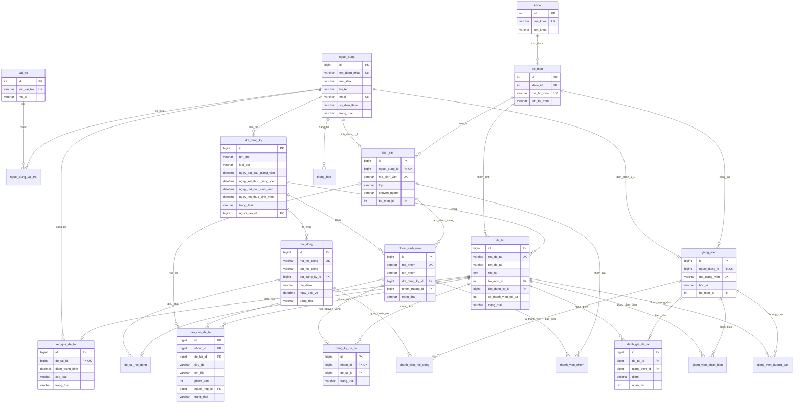

# TÀI LIỆU CƠ SỞ DỮ LIỆU & SƠ ĐỒ THỰC THỂ QUAN HỆ (ERD)
## Hệ Thống Quản Lý Đề Tài Sinh Viên - LTWEBCK

Tài liệu này mô tả chi tiết kiến trúc Cơ sở dữ liệu quan hệ (RDBMS) MySQL 8.0 của hệ thống sau khi đã được refactor toàn bộ định danh bảng và cột sang **tiếng Việt không dấu, snake_case, chữ thường**. Cấu trúc này tối ưu cho việc thuyết trình báo cáo đồ án, trực quan hóa trên sơ đồ ERD (MySQL Workbench / dbdiagram.io) và phản ánh chính xác nghiệp vụ thực tế.

---

## 1. QUY TẮC ĐẶT TÊN VÀ CHUẨN HÓA

- **Định dạng bảng và cột**: `tiếng Việt không dấu`, `snake_case`, `chữ thường`, không dấu cách, không ký tự đặc biệt.
- **Khóa chính**: Đồng nhất sử dụng cột `id` (Auto Increment).
- **Khóa ngoại**: Tên bảng tham chiếu kết hợp với hậu tố `_id` (ví dụ: `nguoi_dung_id`, `vai_tro_id`, `bo_mon_id`, `dot_dang_ky_id`, `de_tai_id`, `nhom_id`, `hoi_dong_id`, `giang_vien_id`, `sinh_vien_id`).
- **Chuẩn hóa CSDL**: Đạt chuẩn 3NF (Third Normal Form), toàn vẹn dữ liệu qua Foreign Key ràng buộc `CASCADE` hoặc `RESTRICT`.

---

## 2. DANH MỤC CÁC BẢNG (21 BẢNG)

| STT | Tên bảng (Tiếng Việt) | Tên bảng cũ (English) | Chức năng nghiệp vụ |
|:---:|:---|:---|:---|
| 1 | `vai_tro` | `roles` | Danh mục 4 vai trò bảo mật hệ thống (ADMIN, TRUONG_KHOA, GIANG_VIEN, SINH_VIEN) |
| 2 | `nguoi_dung` | `users` | Tài khoản đăng nhập, thông tin định danh và mật khẩu BCrypt |
| 3 | `nguoi_dung_vai_tro` | `user_roles` | Bảng trung gian ánh xạ quan hệ N-N giữa người dùng và vai trò |
| 4 | `khoa` | `faculties` | Danh mục Khoa chuyên môn trong trường đại học |
| 5 | `bo_mon` | `departments` | Danh mục Bộ môn chuyên môn trực thuộc Khoa |
| 6 | `giang_vien` | `lecturers` | Hồ sơ học vụ của Giảng viên (mã GV, học vị, bộ môn) |
| 7 | `sinh_vien` | `students` | Hồ sơ học vụ của Sinh viên (MSSV, lớp sinh hoạt, chuyên ngành) |
| 8 | `dot_dang_ky` | `registration_periods` | Đợt đăng ký đề tài với 2 giai đoạn (GV đề xuất & SV chọn đề tài) |
| 9 | `de_tai` | `topics` | Đề tài nghiên cứu / khóa luận tốt nghiệp |
| 10 | `giang_vien_huong_dan` | `topic_lecturers` | Phân công Giảng viên hướng dẫn (chính/phụ) cho đề tài |
| 11 | `nhom_sinh_vien` | `student_groups` | Nhóm sinh viên thực hiện đề tài (1-3 thành viên, 1 nhóm trưởng) |
| 12 | `thanh_vien_nhom` | `group_members` | Danh sách thành viên trực thuộc nhóm sinh viên |
| 13 | `dang_ky_de_tai` | `topic_registrations` | Nguyện vọng đăng ký đề tài của nhóm sinh viên |
| 14 | `bao_cao_de_tai` | `topic_reports` | Báo cáo tiến độ và khóa luận chính thức do nhóm trưởng nộp |
| 15 | `hoi_dong` | `councils` | Hội đồng đánh giá / bảo vệ khóa luận tốt nghiệp |
| 16 | `thanh_vien_hoi_dong` | `council_members` | Giảng viên tham gia hội đồng (Chủ tịch, Thư ký, Ủy viên) |
| 17 | `de_tai_hoi_dong` | `council_topics` | Phân công đề tài vào hội đồng kèm số thứ tự và thời gian bảo vệ |
| 18 | `giang_vien_phan_bien` | `topic_reviewers` | Phân công Giảng viên phản biện độc lập cho đề tài |
| 19 | `danh_gia_de_tai` | `evaluations` | Phiếu chấm điểm và nhận xét chi tiết của Giảng viên |
| 20 | `ket_qua_de_tai` | `topic_results` | Kết quả chung cuộc: điểm trung bình cộng, xếp loại, trạng thái công bố |
| 21 | `thong_bao` | `announcements` | Thông báo học vụ và thông tin điều hành của Khoa |

---

## 3. CHI TIẾT CẤU TRÚC TỪNG BẢNG

### 3.1. Nhóm Định Danh & Phân Quyền

#### Bảng `vai_tro`
- `id` (INT, PK, AUTO_INCREMENT): Mã định danh vai trò.
- `ten_vai_tro` (VARCHAR(50), UNIQUE, NOT NULL): Tên vai trò (`ROLE_ADMIN`, `ROLE_TRUONG_KHOA`, `ROLE_GIANG_VIEN`, `ROLE_SINH_VIEN`).
- `mo_ta` (VARCHAR(255)): Mô tả quyền hạn.

#### Bảng `nguoi_dung`
- `id` (BIGINT, PK, AUTO_INCREMENT): Khóa chính tài khoản.
- `ten_dang_nhap` (VARCHAR(50), UNIQUE, NOT NULL): Tên đăng nhập hệ thống.
- `mat_khau` (VARCHAR(255), NOT NULL): Mật khẩu đã băm một chiều bằng BCrypt (`$2a$...`).
- `ho_ten` (VARCHAR(100), NOT NULL): Họ và tên đầy đủ.
- `email` (VARCHAR(100), UNIQUE, NOT NULL): Email liên lạc.
- `so_dien_thoai` (VARCHAR(20)): Số điện thoại.
- `trang_thai` (VARCHAR(20), NOT NULL, DEFAULT 'ACTIVE'): Trạng thái tài khoản (`ACTIVE`, `LOCKED`).
- `ngay_tao` (TIMESTAMP, DEFAULT CURRENT_TIMESTAMP).
- `ngay_cap_nhat` (TIMESTAMP, DEFAULT CURRENT_TIMESTAMP ON UPDATE CURRENT_TIMESTAMP).
- *Chỉ mục*: `idx_nguoi_dung_trang_thai`, `idx_nguoi_dung_ngay_tao`.

#### Bảng `nguoi_dung_vai_tro`
- `nguoi_dung_id` (BIGINT, PK, FK -> `nguoi_dung.id` ON DELETE CASCADE).
- `vai_tro_id` (INT, PK, FK -> `vai_tro.id` ON DELETE CASCADE).

---

### 3.2. Nhóm Tổ Chức Đào Tạo

#### Bảng `khoa`
- `id` (INT, PK, AUTO_INCREMENT): Mã định danh khoa.
- `ma_khoa` (VARCHAR(20), UNIQUE, NOT NULL): Mã khoa viết tắt (VD: `FIT`).
- `ten_khoa` (VARCHAR(150), NOT NULL): Tên đầy đủ của khoa.
- `mo_ta` (TEXT): Giới thiệu về khoa.

#### Bảng `bo_mon`
- `id` (INT, PK, AUTO_INCREMENT): Mã định danh bộ môn.
- `khoa_id` (INT, NOT NULL, FK -> `khoa.id` ON DELETE RESTRICT): Khoa trực thuộc.
- `ma_bo_mon` (VARCHAR(20), UNIQUE, NOT NULL): Mã bộ môn (VD: `CNPM`, `HTTT`, `MMT`, `KHMT`, `AIDS`).
- `ten_bo_mon` (VARCHAR(150), NOT NULL): Tên bộ môn.
- `mo_ta` (TEXT): Mô tả chuyên ngành bộ môn quản lý.

#### Bảng `giang_vien`
- `id` (BIGINT, PK, AUTO_INCREMENT): Khóa chính hồ sơ giảng viên.
- `nguoi_dung_id` (BIGINT, UNIQUE, NOT NULL, FK -> `nguoi_dung.id` ON DELETE CASCADE): Tài khoản người dùng (quan hệ 1-1).
- `ma_giang_vien` (VARCHAR(20), UNIQUE, NOT NULL): Mã giảng viên (VD: `GV001`).
- `hoc_vi` (VARCHAR(50), NOT NULL, DEFAULT 'Thạc sĩ'): Học vị (Cử nhân, Thạc sĩ, Tiến sĩ, PGS.TS, GS.TS).
- `bo_mon_id` (INT, NOT NULL, FK -> `bo_mon.id` ON DELETE RESTRICT): Bộ môn công tác.

#### Bảng `sinh_vien`
- `id` (BIGINT, PK, AUTO_INCREMENT): Khóa chính hồ sơ sinh viên.
- `nguoi_dung_id` (BIGINT, UNIQUE, NOT NULL, FK -> `nguoi_dung.id` ON DELETE CASCADE): Tài khoản người dùng (quan hệ 1-1).
- `ma_sinh_vien` (VARCHAR(20), UNIQUE, NOT NULL): Mã số sinh viên MSSV (VD: `21110001`).
- `lop` (VARCHAR(50), NOT NULL): Lớp sinh hoạt (VD: `21DTH01`).
- `chuyen_nganh` (VARCHAR(100), NOT NULL): Ngành đào tạo.
- `bo_mon_id` (INT, NOT NULL, FK -> `bo_mon.id` ON DELETE RESTRICT): Bộ môn quản lý chuyên môn.

---

### 3.3. Nhóm Đợt Đăng Ký & Đề Tài

#### Bảng `dot_dang_ky`
- `id` (BIGINT, PK, AUTO_INCREMENT): Khóa chính đợt đăng ký.
- `ten_dot` (VARCHAR(150), NOT NULL): Tên đợt (VD: Khóa luận tốt nghiệp HK2 2025-2026).
- `loai_dot` (VARCHAR(50), NOT NULL): Loại hình (`MON_HOC`, `NCKH`, `TLCN`, `KLTN`).
- `ngay_bat_dau_giang_vien` (DATETIME, NOT NULL): Bắt đầu Giai đoạn 1 (GV nộp đề tài).
- `ngay_ket_thuc_giang_vien` (DATETIME, NOT NULL): Kết thúc Giai đoạn 1.
- `ngay_bat_dau_sinh_vien` (DATETIME, NOT NULL): Bắt đầu Giai đoạn 2 (SV chọn đề tài).
- `ngay_ket_thuc_sinh_vien` (DATETIME, NOT NULL): Kết thúc Giai đoạn 2.
- `han_nop_diem_phan_bien` (DATETIME): Hạn cuối GVPB nộp điểm.
- `ngay_bao_cao` (DATETIME): Ngày tổ chức báo cáo trước hội đồng.
- `trang_thai` (VARCHAR(30), NOT NULL, DEFAULT 'DRAFT'): `DRAFT`, `PHASE_1`, `PHASE_2`, `CLOSED`.
- `nguoi_tao_id` (BIGINT, NOT NULL, FK -> `nguoi_dung.id` ON DELETE RESTRICT): Trưởng khoa khởi tạo.
- `ngay_tao` (TIMESTAMP, DEFAULT CURRENT_TIMESTAMP).

#### Bảng `de_tai`
- `id` (BIGINT, PK, AUTO_INCREMENT): Khóa chính đề tài.
- `ma_de_tai` (VARCHAR(30), UNIQUE, NOT NULL): Mã đề tài (VD: `DT2026-001`).
- `ten_de_tai` (VARCHAR(255), NOT NULL): Tên đề tài khoa học.
- `mo_ta` (TEXT, NOT NULL): Mục tiêu, yêu cầu kỹ thuật và công nghệ.
- `bo_mon_id` (INT, NOT NULL, FK -> `bo_mon.id` ON DELETE RESTRICT): Bộ môn thẩm định.
- `dot_dang_ky_id` (BIGINT, NOT NULL, FK -> `dot_dang_ky.id` ON DELETE RESTRICT): Đợt áp dụng.
- `so_thanh_vien_toi_da` (INT, NOT NULL, DEFAULT 3): Số lượng sinh viên tối đa trong nhóm (mặc định 3).
- `trang_thai` (VARCHAR(30), NOT NULL, DEFAULT 'DRAFT'): `DRAFT`, `PENDING`, `APPROVED`, `REJECTED`, `PUBLISHED`, `ASSIGNED`, `COMPLETED`.
- `ly_do_tu_choi` (VARCHAR(255)): Lý do Trưởng khoa từ chối duyệt đề tài.
- `ngay_tao` (TIMESTAMP, DEFAULT CURRENT_TIMESTAMP).
- `ngay_cap_nhat` (TIMESTAMP, DEFAULT CURRENT_TIMESTAMP ON UPDATE CURRENT_TIMESTAMP).

#### Bảng `giang_vien_huong_dan`
- `id` (BIGINT, PK, AUTO_INCREMENT): Khóa chính quan hệ hướng dẫn.
- `de_tai_id` (BIGINT, NOT NULL, FK -> `de_tai.id` ON DELETE CASCADE).
- `giang_vien_id` (BIGINT, NOT NULL, FK -> `giang_vien.id` ON DELETE RESTRICT).
- `vai_tro_huong_dan` (VARCHAR(30), NOT NULL, DEFAULT 'MAIN'): `MAIN` (GVHD chính), `CO_ADVISOR` (GVHD đồng hành).
- *Ràng buộc UNIQUE*: (`de_tai_id`, `giang_vien_id`) - 1 giảng viên không hướng dẫn trùng lặp trong 1 đề tài.

#### Bảng `giang_vien_phan_bien`
- `id` (BIGINT, PK, AUTO_INCREMENT).
- `de_tai_id` (BIGINT, NOT NULL, FK -> `de_tai.id` ON DELETE CASCADE).
- `giang_vien_id` (BIGINT, NOT NULL, FK -> `giang_vien.id` ON DELETE RESTRICT).
- `ngay_phan_cong` (TIMESTAMP, DEFAULT CURRENT_TIMESTAMP).
- *Ràng buộc UNIQUE*: (`de_tai_id`, `giang_vien_id`).
- *Business Rule*: Giảng viên phản biện tuyệt đối không trùng với bất kỳ GVHD nào của đề tài.

---

### 3.4. Nhóm Sinh Viên, Đăng Ký & Báo Cáo

#### Bảng `nhom_sinh_vien`
- `id` (BIGINT, PK, AUTO_INCREMENT): Khóa chính nhóm.
- `ma_nhom` (VARCHAR(30), UNIQUE, NOT NULL): Mã nhóm (VD: `GRP-2026-001`).
- `ten_nhom` (VARCHAR(100), NOT NULL): Tên nhóm tự đặt.
- `dot_dang_ky_id` (BIGINT, NOT NULL, FK -> `dot_dang_ky.id` ON DELETE RESTRICT).
- `nhom_truong_id` (BIGINT, NOT NULL, FK -> `sinh_vien.id` ON DELETE RESTRICT): Trưởng nhóm (bắt buộc).
- `trang_thai` (VARCHAR(30), NOT NULL, DEFAULT 'ACTIVE'): `ACTIVE`, `DISBANDED`.
- `ngay_tao` (TIMESTAMP, DEFAULT CURRENT_TIMESTAMP).

#### Bảng `thanh_vien_nhom`
- `id` (BIGINT, PK, AUTO_INCREMENT).
- `nhom_id` (BIGINT, NOT NULL, FK -> `nhom_sinh_vien.id` ON DELETE CASCADE).
- `sinh_vien_id` (BIGINT, NOT NULL, FK -> `sinh_vien.id` ON DELETE RESTRICT).
- `ngay_tham_gia` (TIMESTAMP, DEFAULT CURRENT_TIMESTAMP).
- *Ràng buộc UNIQUE*: (`nhom_id`, `sinh_vien_id`).

#### Bảng `dang_ky_de_tai`
- `id` (BIGINT, PK, AUTO_INCREMENT).
- `nhom_id` (BIGINT, UNIQUE, NOT NULL, FK -> `nhom_sinh_vien.id` ON DELETE CASCADE): Mỗi nhóm chỉ đăng ký 1 đề tài.
- `de_tai_id` (BIGINT, NOT NULL, FK -> `de_tai.id` ON DELETE RESTRICT).
- `ngay_dang_ky` (TIMESTAMP, DEFAULT CURRENT_TIMESTAMP).
- `trang_thai` (VARCHAR(30), NOT NULL, DEFAULT 'PENDING'): `PENDING`, `APPROVED`, `REJECTED`.
- `ghi_chu` (VARCHAR(255)): Lời nhắn hoặc lý do từ chối của Trưởng khoa.

#### Bảng `bao_cao_de_tai`
- `id` (BIGINT, PK, AUTO_INCREMENT).
- `nhom_id` (BIGINT, NOT NULL, FK -> `nhom_sinh_vien.id` ON DELETE CASCADE).
- `de_tai_id` (BIGINT, NOT NULL, FK -> `de_tai.id` ON DELETE RESTRICT).
- `tieu_de` (VARCHAR(200), NOT NULL): Tiêu đề cột mốc báo cáo (VD: Báo cáo Tiến độ Tuần 4).
- `ten_file` (VARCHAR(255), NOT NULL): Tên file gốc người dùng tải lên.
- `duong_dan_file` (VARCHAR(255), NOT NULL): Đường dẫn lưu trữ vật lý trên server.
- `kich_thuoc_file` (BIGINT, NOT NULL): Dung lượng file (bytes).
- `phien_ban` (INT, NOT NULL, DEFAULT 1): Phiên bản nộp (v1, v2...).
- `nguoi_nop_id` (BIGINT, NOT NULL, FK -> `sinh_vien.id` ON DELETE RESTRICT): Bắt buộc là Nhóm trưởng.
- `ngay_nop` (TIMESTAMP, DEFAULT CURRENT_TIMESTAMP).
- `ghi_chu` (TEXT): Lời nhắn của sinh viên.
- `nhan_xet_giang_vien` (TEXT): Phản hồi, nhận xét của GVHD.
- `trang_thai` (VARCHAR(30), NOT NULL, DEFAULT 'SUBMITTED'): `SUBMITTED`, `REVIEWED`.

---

### 3.5. Nhóm Hội Đồng & Đánh Giá Điểm

#### Bảng `hoi_dong`
- `id` (BIGINT, PK, AUTO_INCREMENT): Khóa chính hội đồng.
- `ma_hoi_dong` (VARCHAR(30), UNIQUE, NOT NULL): Mã hội đồng (VD: `HD-2026-01`).
- `ten_hoi_dong` (VARCHAR(150), NOT NULL): Tên hội đồng đánh giá.
- `dot_dang_ky_id` (BIGINT, NOT NULL, FK -> `dot_dang_ky.id` ON DELETE RESTRICT).
- `dia_diem` (VARCHAR(100), NOT NULL): Phòng tổ chức bảo vệ (VD: Phòng Hội thảo C.102).
- `ngay_bao_ve` (DATETIME, NOT NULL): Ngày giờ bắt đầu chấm.
- `trang_thai` (VARCHAR(30), NOT NULL, DEFAULT 'CREATED'): `CREATED`, `ACTIVE`, `FINISHED`.
- `ngay_tao` (TIMESTAMP, DEFAULT CURRENT_TIMESTAMP).

#### Bảng `thanh_vien_hoi_dong`
- `id` (BIGINT, PK, AUTO_INCREMENT).
- `hoi_dong_id` (BIGINT, NOT NULL, FK -> `hoi_dong.id` ON DELETE CASCADE).
- `giang_vien_id` (BIGINT, NOT NULL, FK -> `giang_vien.id` ON DELETE RESTRICT).
- `vai_tro` (VARCHAR(30), NOT NULL, DEFAULT 'MEMBER'): `CHAIRMAN` (Chủ tịch), `SECRETARY` (Thư ký), `MEMBER` (Ủy viên).
- *Ràng buộc UNIQUE*: (`hoi_dong_id`, `giang_vien_id`).

#### Bảng `de_tai_hoi_dong`
- `id` (BIGINT, PK, AUTO_INCREMENT).
- `hoi_dong_id` (BIGINT, NOT NULL, FK -> `hoi_dong.id` ON DELETE CASCADE).
- `de_tai_id` (BIGINT, UNIQUE, NOT NULL, FK -> `de_tai.id` ON DELETE RESTRICT): Mỗi đề tài chỉ báo cáo tại đúng 1 Hội đồng.
- `thu_tu_bao_ve` (INT, NOT NULL, DEFAULT 1): Số thứ tự ca báo cáo.
- `gio_bao_ve` (TIME): Thời gian dự kiến.

#### Bảng `danh_gia_de_tai`
- `id` (BIGINT, PK, AUTO_INCREMENT): Khóa chính phiếu chấm điểm.
- `de_tai_id` (BIGINT, NOT NULL, FK -> `de_tai.id` ON DELETE CASCADE).
- `giang_vien_id` (BIGINT, NOT NULL, FK -> `giang_vien.id` ON DELETE RESTRICT).
- `diem` (DECIMAL(4, 2), NOT NULL): Điểm số đánh giá từ 0.00 đến 10.00.
- `nhan_xet` (TEXT): Nhận xét chi tiết về đề tài.
- `ngay_cham` (TIMESTAMP, DEFAULT CURRENT_TIMESTAMP).
- *Ràng buộc UNIQUE*: (`de_tai_id`, `giang_vien_id`) - Mỗi giảng viên chỉ nộp đúng 1 phiếu điểm cho 1 đề tài.
- *Security Rule*: Giảng viên hướng dẫn của đề tài KHÔNG ĐƯỢC PHÉP có bản ghi trong bảng này cho đề tài đó.

#### Bảng `ket_qua_de_tai`
- `id` (BIGINT, PK, AUTO_INCREMENT).
- `de_tai_id` (BIGINT, UNIQUE, NOT NULL, FK -> `de_tai.id` ON DELETE CASCADE): Mỗi đề tài có đúng 1 kết quả tổng kết.
- `diem_trung_binh` (DECIMAL(4, 2), NOT NULL): Điểm trung bình cộng các thành viên chấm.
- `xep_loai` (VARCHAR(20), NOT NULL): `XUAT_SAC`, `GIOI`, `KHA`, `TRUNG_BINH`, `KHONG_DAT`.
- `trang_thai` (VARCHAR(30), NOT NULL, DEFAULT 'PENDING_PUBLISH'): `PENDING_PUBLISH`, `PUBLISHED`.
- `ngay_cong_bo` (DATETIME): Thời điểm Trưởng khoa bấm công bố điểm.
- `nguoi_cong_bo_id` (BIGINT, FK -> `nguoi_dung.id` ON DELETE SET NULL): Trưởng khoa thực hiện duyệt.

#### Bảng `thong_bao`
- `id` (BIGINT, PK, AUTO_INCREMENT).
- `tieu_de` (VARCHAR(255), NOT NULL): Tiêu đề thông báo học vụ.
- `noi_dung` (TEXT, NOT NULL): Chi tiết thông báo.
- `kich_hoat` (BOOLEAN, NOT NULL, DEFAULT TRUE): Đang hiển thị hay tạm ẩn.
- `nguoi_tao_id` (BIGINT, NOT NULL, FK -> `nguoi_dung.id` ON DELETE RESTRICT): Người đăng thông báo.
- `ngay_tao` (TIMESTAMP, DEFAULT CURRENT_TIMESTAMP).
- `ngay_cap_nhat` (TIMESTAMP, DEFAULT CURRENT_TIMESTAMP ON UPDATE CURRENT_TIMESTAMP).

---

## 4. SƠ ĐỒ THỰC THỂ QUAN HỆ (MERMAID ERD DIAGRAM)

